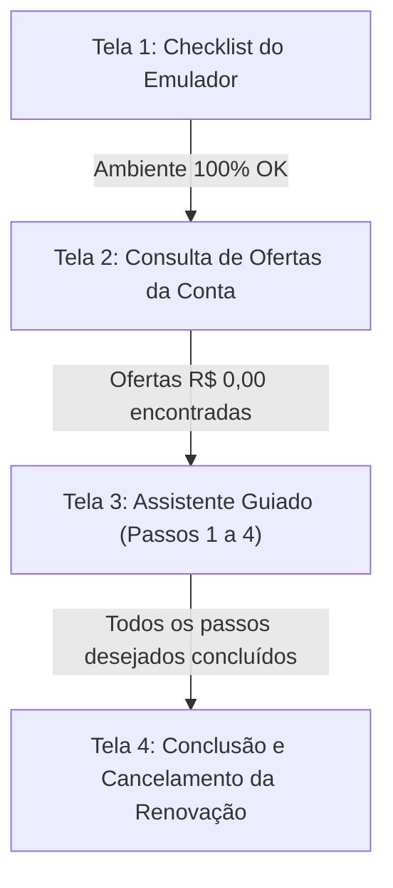

# Solari — Arquitetura 100% Rust + Tauri v2

## 1. Objetivo

Construir um aplicativo desktop nativo, leve (~5–8 MB) e **livre de Python** usando **Tauri v2**, com todo o motor de automação escrito diretamente em **Rust** (`src-tauri`) e interface reativa em **React + TypeScript + Tailwind CSS**.

### Vantagens da Arquitetura 100% Rust (Zero Python)
- **Instalador ultraleve (~5–8 MB)** em vez de ~100 MB de um bundle PyInstaller.
- **Sem falsos-positivos de empacotadores Python** no Windows Defender.
- **Inicialização instantânea** e zero dependências externas na máquina do usuário.
- **Comunicação direta via IPC do Tauri** (`#[tauri::command]` + `app.emit(...)`), sem processos intermediários no Windows.

---

## 2. Stack Tecnológica

### Frontend (`src/`)
- **React + TypeScript + Vite**
- **Tailwind CSS** (tema escuro moderno e responsivo)
- **`@tauri-apps/api`** (`invoke` para acionar comandos Rust e `listen` para receber eventos em tempo real)

### Backend Nativo (`src-tauri/`)
| Responsabilidade | Implementação / Crates Rust |
| :--- | :--- |
| **Runtime Assíncrono & Processos** | `tokio` (`process::Command`, `io::BufReader` assíncrono com `CREATE_NO_WINDOW`) |
| **Download de Ferramentas sob Demanda** | `reqwest` (`stream` + `rustls-tls`) salvando em `%LOCALAPPDATA%\Solari\bin\` |
| **Descompactação (`platform-tools` & `.xz`)** | `zip` (para `platform-tools-latest-windows.zip`) + `xz2` (para o binário Android `.xz`) |
| **Leitura do `library.db` (`purchaseToken`)** | `rusqlite` (`features = ["bundled"]`) — consulta SQLite 100% nativa em Rust |
| **Recursos Embutidos** | `include_bytes!()` e `include_str!()` para embutir o módulo auxiliar Android e o template JS direto no executável |
| **Serialização & Eventos** | `serde` + `serde_json` + `tauri::Emitter` |
| **2FA / TOTP Opcional** | `hmac` + `sha1` + `data-encoding` (Base32) |

---

## 3. Módulos Internos do `src-tauri`

```text
src-tauri/
├── assets/
│   ├── module_521.apk          # Embutido no binário via include_bytes!
│   └── billing_runner.js       # Template JS embutido via include_str!
└── src/
    ├── main.rs / lib.rs        # Registro dos comandos Tauri e gerenciamento de estado
    ├── adb.rs                  # Descoberta/download do adb.exe, conexão MuMu e wrappers adb shell/push/pull
    ├── device.rs               # Checagem de Root, limpeza de proxy, verificação da Play Store e Google One
    ├── runner.rs               # Envio do utilitário standalone Android (16.5.9) + streaming JSON via stdout
    ├── sqlite_token.rs         # Extração do purchaseToken vigente a partir do library.db usando rusqlite
    └── commands.rs             # Endpoints #[tauri::command] expostos para o frontend React
```

### Como o Rust se comunica com o Android sem Python no Windows

1. O módulo `device.rs` detecta a arquitetura do emulador via `adb shell getprop ro.product.cpu.abi` (`x86_64`, `arm64-v8a`, etc.).
2. Na primeira execução, `runner.rs` baixa o utilitário standalone oficial **`frida-inject-16.5.9-android-<arch>.xz`** direto do GitHub Releases, descompacta em memória com `xz2` e faz cache local em `%LOCALAPPDATA%\Solari\bin\`, enviando-o para `/data/local/tmp/` no Android junto com `module_521.apk`.
3. Para consultar ofertas ou iniciar uma etapa, `runner.rs` gera o script JS configurado para o plano (`pro12`, `pro6`, `pro6b`, `pro6c`), envia para `/data/local/tmp/solari_task.js` e executa via `tokio::process::Command`:
   ```text
   adb -s <serial> shell /data/local/tmp/frida-inject -p <pid> -s /data/local/tmp/solari_task.js
   ```
4. No script JS, a função `S(obj)` emite `console.log("__SOLARI__" + JSON.stringify(obj))`. O `BufReader` assíncrono do Rust lê cada linha em tempo real, faz o parse JSON com `serde_json` e dispara `app.emit("solari://event", payload)` diretamente para a interface React!

---

## 4. Comandos Tauri (`#[tauri::command]`)

| Comando Tauri | Retorno / Eventos | Descrição |
| :--- | :--- | :--- |
| `check_environment()` | `EnvReport` + progresso | Localiza/baixa ADB, conecta nas portas do emulador (`16384`, `7555`, etc.), ativa `adb root`, valida pacotes Play Store e Google One e prepara binários no `/data/local/tmp/`. |
| `list_offers()` | `Vec<OfferItem>` | Executa consulta somente-leitura (`LIST_ONLY = true`) no SKU `g1.2tb.ai.subs_variant` e retorna todas as ofertas com preço e duração. |
| `start_step(step_id)` | Stream `solari://event` | Executa `pro12` (sem stack) ou `pro6` / `pro6b` / `pro6c` (extraindo `purchaseToken` via `sqlite_token.rs` e aplicando `SubscriptionUpdateParams` com `mode = 5`), aguardando `purchase_cb`. |
| `cancel_active_task()` | `()` | Encerra imediatamente qualquer processo `adb` em andamento caso o usuário cancele na UI. |
| `open_subscriptions_url()` | `()` | Abre `https://play.google.com/store/account/subscriptions` no navegador ou dentro do emulador para conferência/cancelamento final. |

---

## 5. Desenho das Telas (UX Flow)



1. **Tela 1 — Checklist de Conexão e Ambiente:**
   - Indicadores visuais em tempo real: *ADB Pronto*, *Emulador Conectado*, *Permissão Root*, *Play Store & Google One Instalados* e *Motor Android Pronto*.
2. **Tela 2 — Elegibilidade da Conta:**
   - Botão **`Verificar Ofertas da Conta (Sem Risco)`** exibindo cartões para cada oferta encontrada (`12 meses`, `+6m`, `+6m`, `+6m extra`) e calculando o total acumulável (até **30 meses**).
3. **Tela 3 — Assistente de Acumulação (Wizard):**
   - Linha do tempo com as **4 etapas sequenciais**, travas contra cliques fora de ordem, aviso claro para conferir **R$ 0,00 hoje** e avanço da data no checkout do emulador, e avanço automático ao receber `purchase_cb (code = 0)`.
4. **Tela 4 — Finalização Segura:**
   - Resumo do período total acumulado e botão de destaque para abrir a página de assinaturas da Google Play e **cancelar a renovação automática** com segurança.
